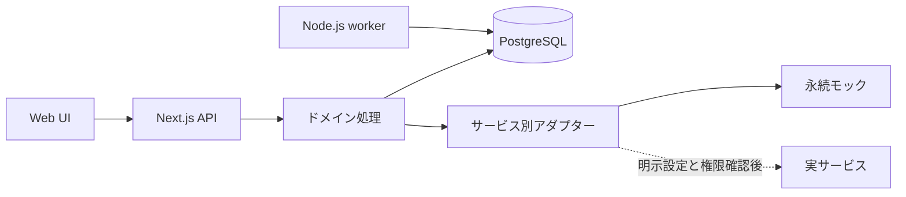

# アーキテクチャ

## 構成

Next.jsの単一アプリをUIと認証付きAPIに使い、ドメイン処理と外部サービス境界を分けます。永続データはPostgreSQLとPrismaで管理し、非同期実行はDBのジョブ表を使うNode.jsワーカーが担当します。初期実装はローカルで動くモックアダプターを使います。

## 境界と安全

API入口で入力をZod検証し、未認証要求を拒否します。モックは外向き通信をしません。サービス状態はAPIと画面に個別のmode、connection_status、labelで示します。認証と権限確認の両方が成功するまで実接続済みとは表示しません。

メール送信や外部確定操作には操作ごとの承認記録を要求します。承認は対象・内容ハッシュ・操作種別・期限に結び付け、実行直前に再検証します。既定では無効です。

## 実装範囲

単一ユーザーのタスクを中心にします。タスク以外の独立したIdeaやProject管理は作りません。Notionはタスク同期、Google Driveは成果物保存の将来の正本です。資格情報が無い間は対応するモックを使い、実接続失敗をモック成功に置き換えません。

## 運用

`npm run dev` はWebアプリを起動し、`npm run worker` はワーカーを起動します。Composeはアプリ、ワーカー、PostgreSQLを同じネットワークで起動します。データベースとファイル領域は名前付きボリュームに保存します。
