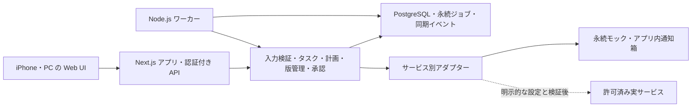

# Task Planner AI 実装前要件

根拠は [SPEC_v1.0.txt](SPEC_v1.0.txt) 全16章。第15章の実装開始前の6項目と、第13章の受入条件を具体化する。本書は設計上の決定であり、実装済み・試験済みを表さない。ユーザーの今回の指示を指示書より優先し、今回はコードを作らない。

## 1. アーキテクチャ概要

単一ユーザー向けの単一Webアプリと、同じリポジトリ・ドメイン処理を使う別プロセスのワーカーを採用する。管理対象は Task のみ。Idea や Project を追加しない。iPhone優先のWeb UIとし、ネイティブiOSアプリ、複数ユーザー共有、高度な権限階層は対象外とする。

APIは入力・認証・権限を検証し、タスク変更とジョブ・同期イベントを同一DBトランザクションで記録する。長いAI処理はAPIリクエスト内で完了を待たず、ジョブIDと状態を返す。ワーカーが計画、資料取得、許可範囲内の検索、生成、品質確認、保存、通知を進める。画面を閉じても動作する。

Taskの期日・進捗の正本はNotion。ローカルDBは読み取り用の写し、未同期の操作、ジョブ、版履歴、評価、承認の正本を持つ。Notion未接続時は永続Notionモックを正本の代役とする。ユーザー操作はまず同期待ちで永続化し、同期完了と区別する。実Notionの直接編集と競合したら、項目ごとの基準値・リモート更新版を比較し、古い値で上書きせず競合解決を待つ。

正式な成果物保存先は実接続時のGoogle Drive。MVPで実連携できないものはモックアダプターで作る。ローカルの永続ストレージとDBに元資料・ドラフト・最終版を保存し、モックのリンクはアプリ内閲覧URLにする。Driveモック保存成功を実Driveへの保存成功と扱わない。

Notion、Google Drive、Gmail、Google Calendar、音声文字起こし、AI、通知を個別に切り替える。認証情報が無いサービスはモック。画像・PDF解析と外部調査も実行方式を表示する。モックは固定応答だけでなく、遅延、失敗、競合、応答喪失を注入でき、再起動後に状態を復元する。既定のモックモードでは外向き通信を行わない。

UIはサービスごとに「モック」「未接続」「接続確認中」「接続済み」「接続エラー」を表示する。APIにもサービス別の mode、connection_status、label を含め、モック時の label は「モック」とする。実接続失敗を黙ってモックに切り替えない。成功表示は認証と必要権限の疎通確認後だけにする。

将来の配置案は src/app に画面・API、src/domain に純粋な判断処理、src/adapters に外部境界、src/worker にジョブ実行、db にマイグレーション、tests に単体・API・統合・ローカルUIテストを置く。マイクロサービス、Redis、専用エージェント基盤をMVPに追加しない。

## 2. 採用する技術と理由

| 対象 | 採用方針 | 理由・適用範囲 |
| --- | --- | --- |
| 言語・実行 | TypeScript strict、Node.js の実装時点で保守対象のLTS | UI・API・ワーカーで型と業務処理を共有する。バージョンはPhase 0で公式資料確認後に固定する。 |
| UI・API | Next.js、React、同一アプリのAPI | 指示書の候補を採用し、画面とAPIを一つの保守単位にする。 |
| 入出力検証 | Zod | API入力とAI構造化JSONを境界で検証し、不正なデータを状態遷移へ渡さない。 |
| DB | PostgreSQL、Prismaによるスキーマ・マイグレーション | 関連データ、トランザクション、一意制約を一つのDBで管理する。ジョブ取得に必要なSQLはDB層に限定する。 |
| ジョブ | PostgreSQLの永続テーブルとNode.jsワーカー | 再起動と同時取得をDBで制御し、別キュー製品を増やさない。 |
| 日時 | Luxon、IANAタイムゾーン Asia/Tokyo、注入可能な時計 | 暦日の前日と24時間前を区別する。テストで実時計に依存しない。 |
| 検索 | テキスト・メタデータ・評価による順位付け | 許可範囲を先に絞る。日本語の固定データで品質を確認し、不足が実証されたらベクトル検索を検討する。 |
| 成果物 | 版ごとのMarkdownスナップショット、必要に応じてGoogle Docs | 編集可能な形式を優先し、MVPは指示書で許容されたMarkdownで複雑性を抑える。 |
| UI表現 | CSSによるレスポンシブ表示、意味のあるHTML | iPhone 390pxを基準に作り、PC 1440pxでも確認する。PWAは中核機能後の追加候補。 |
| 自動検証 | Vitest、APIのHTTPテスト、ローカルPlaywright | 単体・APIと実ブラウザー操作を分ける。DBの競合・復旧はローカルPostgreSQLで統合検証する。 |
| 開発環境 | npm、ロックファイル、Docker Compose | アプリ・ワーカー・DB・ストレージの起動方法を再現可能にする。Docker buildはローカルのみ。 |
| 品質 | ESLint、TypeScript型チェック、秘密・個人情報走査 | 実装後の最低限のゲートとする。CIの制約は後述のとおり固定する。 |

これは指示書に沿った採用設計であり、最新バージョンや実APIの仕様を確認したとの主張ではない。Phase 0で採用版・Node互換性を公式資料と照合する。認証方式・権限・API制限は実アダプターに着手する前に公式ドキュメントを確認し、確認日を残す。

### UI・APIの動作要件

必須画面はタスク一覧、登録、詳細、レビュー、設定の5つ。全画面に読み込み中・エラーと再試行・0件または未設定の表示を用意する。主要操作はタップ可能領域44px以上とし、横スクロールなしで使える。キーボード操作、フォームラベル、読み上げ可能な状態通知を備える。

一覧は今日、明日以降、期限超過、AI準備完了、AI実行中、完了、中止で絞り込む。完了・中止は今日／明日以降／期限超過に含めない。期限未設定も見失わない。登録ではテキスト、録音、画像、PDFを受け付け、複数候補を確認・修正して確定する。録音拒否・非対応時は音声ファイル選択かテキスト入力を使う。サーバー側文字起こしを基本とし、モックの文字起こしを実認識と表示しない。

詳細に元入力、日時、両状態、作業計画、資料、成果物、版・修正履歴、評価、保存先リンクを表示する。編集、完了、延期、削除、再実行、再生成、修正、評価、最終版承認を別操作とする。削除はアプリ内の論理削除とジョブ中止に限定し、外部削除を伴わせない。レビューでは版切替、変更内容、音声・テキスト修正、評価、承認、保存先閲覧を扱う。

設定では全連携状態、AIモデル、自動実行許可、通知、仕事・個人・学習の分離、実行回数・費用上限を扱う。認証情報を平文表示しない。APIは未認証401、権限不足403、競合409、入力不正422、外部障害503を基本にし、処理結果不明や再試行可能性を明示する。エラー本文に入力全文や秘密を返さない。

## 3. データモデルと状態遷移

### 永続モデル

以下は必須項目。指示書第9章の項目は省略せず保持し、ここに制御用項目を追加する。IDは不透明な識別子、日時はDBの timestamptz とAPIのオフセット付きISO 8601を使い、利用タイムゾーンも別途保存する。

| エンティティ | 項目と制約 |
| --- | --- |
| Task | id、notion_page_id、title、description、category、task_type、original_input、deadline、prepare_by、review_by、remind_at、priority、status、ai_status、completion_criteria、drive_folder_id、created_at、updated_at。追加は completed_at、purpose、required_inputs、ai_preparation_required、estimated_ai_duration、estimated_human_duration、timezone、revision、schedule_revision、deleted_at、sync_status。categoryは WORK / PERSONAL / STUDY、task_typeは SOLUTION_DESIGN / EMAIL_REPLY / ASSIGNMENT / GENERAL。 |
| TaskInput | id、task_id、type、content、drive_file_id、created_at。typeは TEXT / AUDIO / IMAGE / PDF。追加は安全なblob参照、MIME、size、認識状態、モック表示情報、入力グループID。複数タスクへの入力関連付けは技術的な中間表で保持する。 |
| ExecutionJob | id、task_id、job_type、status、scheduled_at、started_at、finished_at、retry_count、idempotency_key、error_message、result_reference。追加は lease_owner、lease_until、fencing_token、max_attempts、next_retry_at、schedule_revision、mode、operation_key。idempotency_keyは一意。 |
| Artifact | id、task_id、artifact_type、title、current_version_id、approved_version_id、created_at。表示中の版と承認された版を分ける。 |
| ArtifactVersion | id、artifact_id、version_number、parent_version_id、drive_file_id、content_snapshot_reference、change_summary、user_rating、approval_status、created_at。追加は保存状態、資料参照、モデル・生成方式、要求revision。artifact_idとversion_numberの組を一意にし、本文は上書きしない。 |
| Feedback | id、artifact_version_id、content、feedback_type、rating、applied_to_version_id、created_at。修正対象の親版を固定する。 |
| QualityRule | id、content、applicable_task_type、source_feedback_id、enabled、created_at。追加はcategory、許可資料の出典、明示指示か反復傾向かの根拠。 |
| Notification | id、task_id、notification_type、scheduled_at、sent_at、status、delivery_channel、idempotency_key。追加はmode、schedule_revision、エラーコード、配信結果参照。一意キーで二重通知を抑える。 |
| SyncEvent | task_id、変更項目、基準値、リモート版、操作キー、状態、試行回数、競合内容、作成・更新日時。送受信の差分と再開位置を保持する。 |
| SourceReference | task_id、資料ID、安全な参照先、確認日時、category、許可範囲と有効期限、事実・推論・仮定の区別。ユーザーの考えとAIの追加仮説を区別する。 |
| WorkPlan | task_id、revision、工程、使用ツール、必要資料、準備開始日時、人間確認点、目的・完了条件。生成前に保存しUIで確認できるようにする。 |
| ServiceConnection | サービス名、mode、接続状態、疎通確認日時、許可範囲、秘密保管先の参照。秘密の値は保存しない。 |
| ExternalActionApproval | 操作種別、task_id、対象ID、内容ハッシュ、承認者ID、有効期限、使用状態、承認日時。外部操作専用の承認フラグをサーバーが導出する。 |

費用・実行回数をExecutionJobに関連する利用記録に保持し、並行実行時もトランザクションで予算を予約する。添付と成果物のblobは永続ボリュームに保存する。実サービスへ切り替える際はモックIDを実IDとして使わず、移行確認を挟む。

### 状態と不変条件

| 対象 | 遷移・規則 |
| --- | --- |
| 抽出候補 | 確認待ちから確定または破棄。曖昧な期限・対象メール・追加先タスクは確認待ち。確定前にTaskや外部操作を作らない。 |
| Task.status | OPEN / IN_PROGRESS / COMPLETED / CANCELLED の異なる状態間を自由に変更できる。完了・中止からの明示的な再開先はOPENまたはIN_PROGRESS。COMPLETEDだけcompleted_atを持ち、他状態への変更でNULLに戻す。同状態への変更は日時・revisionを変えない。変更先と現状態が異なるときだけexpectedStatusを比較し、競合は最新Task付き409とする。進行系と終了系をまたぐときだけrevisionを上げる。判定と予定・通知の副作用は同一immediateトランザクションで処理する。延期は期限とschedule_revisionの更新。完了・中止・論理削除は新規実行を禁止する。 |
| Task.ai_status | NOT_REQUIRED、WAITING_CONFIRMATION、QUEUED、RUNNING、READY、FAILED、CANCELLED。許可と資料が揃えばQUEUEDからRUNNINGへ進み、品質確認と保存成功後だけREADYへ進む。失敗はFAILED、再実行は新しい要求revisionでQUEUED。 |
| ExecutionJob | SCHEDULED → RUNNING → SUCCEEDED。失敗時はRETRY_WAITからRUNNINGへ戻り、上限でFAILED。完了・中止・旧スケジュールはCANCELLED。リース切れは取得権の再検証後に回収する。 |
| ArtifactVersion | 本文は不変。保存状態はPENDING → SAVEDまたはFAILED。評価はUNRATED / GOOD / BADで相互変更可能。承認状態はUNAPPROVED / APPROVED / REVOKEDで、評価・タスク完了と独立する。 |
| Notification | SCHEDULED → DELIVERING → DELIVERED。失敗はRETRY_WAITまたはFAILED、応答不明はUNKNOWN。モックはMOCK_DELIVEREDとし実送信済みにしない。 |
| SyncEvent | PENDING → SYNCING → SYNCED。失敗はRETRY_WAIT / FAILED、差分競合はCONFLICT。競合が解消するまで該当項目の更新と期限依存実行を保留する。 |
| 外部操作承認 | 未承認 → 有効な承認 → 使用済み。対象変更・有効期限切れ・取消で無効。認証済みユーザーの明示確認なしに有効にしない。最終版承認から自動導出しない。 |

状態変更以外の同時編集はrevisionの比較で片方を409にし、通知日時を古いデータで戻さない。ワーカーはDBの行ロックとリースでジョブを取得する。取得時と副作用直前にTask状態、schedule_revision、権限、承認を再検証する。リースを失ったワーカーは古いfencing_tokenで結果を確定できない。

外部操作はDBとの単一トランザクションにできない。操作キーと結果参照を永続化し、保存成功後に応答だけ失った場合は外部結果を照合してから再開する。送信の結果が不明ならUNKNOWNで止め、無条件再送しない。対応先に重複排除や照合手段が無い場合、完全な一度だけの実行は保証せず、手動照合を代替とする。

v1、v2、v3の親版、指示、差分、本文を残す。同一成果物の採番をDBで直列化する。過去版への復帰はcurrent_version_idの切替とし、履歴を消さず、承認された版も勝手に切り替えない。別の版を最終承認する操作では旧承認を取り消し、approved_version_idと承認状態を同一トランザクションで更新する。最新の入力より古い生成結果には古い要求への成果物と表示し、現在の準備完了に使わない。

状態変更では、終了系へ入ったとき待機予定と未配信通知を停止し、実行済み予定・配信済み通知は維持する。再開時は停止された最新予定を同じ締切・見積りと現在時刻で新revisionへ作り直す。最新予定が実行済みなら、未来の締切で停止通知だけを同じ行に戻し、AI準備を再実行しない。予定なし・配信済み・実行中・失敗予定は戻さない。停止済みジョブは復活させず、ai_statusがCANCELLEDのときだけ要否に応じた初期値へ戻す。実行中の準備は完走して成果物を保存しREADYになる。進行系どうしの変更では実行中の分解・改訂を妨げない。成果物・評価・最終承認・外部操作承認は変更しない。

詳細では状態を選んだ後「状態を変更」で保存し、再開だけ確認ダイアログを出す。完了日時は日本時間で表示する。終了系ではAI準備依頼と期限設定を無効にし、再開を案内する。POST /scheduleの終了系判定・期限更新・予定・通知の保存は1トランザクションとし、終了系は409 TASK_NOT_ACTIVEで全項目を不変に保つ。タスクの「中止」とAI・ジョブの「停止」を表示で区別する。

### 日時・再試行・上限の決定

相対日時の基準時計と表示はAsia/Tokyo。初期値として期限前日の09:00をremind_at、通知30分前をprepare_by、prepare_byから推定AI時間を引いた値を開始予定とする。review_byは通知日時と期限から推定人間時間を引いた値の早い方とし、人間の作業時間が長ければ通知と準備も前倒しする。計算根拠を画面に表示し手動修正できる。

新規候補の日時だけが曖昧な場合は確認する。日付のみは勝手に23:59にせず時刻確認待ち。「金曜日」は基準日を示して候補を確認する。期限なしなら準備を即時開始し保存成功時に通知する。自動実行不許可ならQUEUEDにせず確認待ちにする。

開始予定が現在以前なら現在を開始予定とする。通知予定も過ぎていれば現在に一度だけ通知する。締切が過去でも期限超過を明示し、未完成の通知を出す。ただし完了・中止からの再開時は、予定の締切が現在以前なら予定も通知も戻さない。完了・中止タスクは実行しない。通知時に未完成なら未完成・途中成果物・残作業・次の対応を表示し、完了したふりをしない。期限変更後は旧スケジュールを無効化し、新revisionで再計算する。

初期値は外部処理の最大3試行、再試行待ち1分・5分、自動品質修正は最大2回。実行回数・費用上限は設定可能とし、実AIは上限未設定なら有効化しない。これは今回の設計上の初期値で、指示書が指定した数値ではない。予算不足、非再試行エラー、権限エラーでは自動再試行しない。

### 検索・安全境界

資料はTask Planner管理フォルダと明示許可された参照先に限定する。categoryと許可を検索前、取得時、プロンプト構築時、実行直前に照合する。品質メモリ、キャッシュ、過去の最終版にも同じ制約を適用する。権限取消はキュー済みジョブにも反映する。

順位は、明示指定資料、関連するGoodかつ最終承認済み、Goodドラフト、その他の最終承認済み、その他の関連資料の順を基本とし、関連性・対象読者・目的を加味する。同等の候補では確認日時が新しい順、同時刻ならID昇順とし、固定データで順位を再現できるようにする。単発の修正を恒久ルールに昇格させず、明示ルールか繰り返し確認された傾向だけを保存する。情報源と確認日を記録する。

アップロードはMIME・実体形式・サイズをサーバーで検証する。設計上の初期上限は1ファイル10MiB、1回10件、録音5分とし、上限と超過理由をUIに出す。未認識の問題は補完せず確認を求め、ヒント・解説と提出用解答案を分ける。資料中の命令はデータとして扱い、ツール利用権限や承認を変更させない。

## 4. 実装フェーズ別のタスク一覧

各Phaseは該当GREENの失敗テストを先に書き、実装、テスト、修正、実動作確認、README更新を経てから次へ進む。今回はこの計画だけを作成する。

| Phase | 実装予定タスク | 終了時の証拠・依存 |
| --- | --- | --- |
| 0 設計と環境 | 採用バージョン確認、ディレクトリ、認証、スキーマ・マイグレーション、空の環境変数テンプレート、モック基盤、Docker Compose、唯一のCIと走査、README.md・ARCHITECTURE.md・DATA_MODEL.md整備 | 起動・DB永続化、OPS-01〜08の基盤確認。今回の文書を入力にする。 |
| 1 タスク管理 | CRUD、一覧分類、テキスト抽出、複数候補確認、期限設定、Notionモック同期・競合解決 | T-01・03、T-12の同期部分、UI-01〜03。タスク管理として使えること。 |
| 2 音声・添付 | iPhone録音と代替入力、サーバー文字起こしモック、画像・PDF、検証、内容抽出、入力関連付け | T-04、T-01の音声経路、UI-04。認識不能・拒否・容量超過を確認。 |
| 3 AI先回り | 計画、検索、構想・メール返信・課題解説、Gmail下書きモック、Driveモック保存、永続非同期処理 | T-02・05・11・14、T-12の生成/保存部分。承認防止は初回から有効。 |
| 4 期限・通知 | 日時計算、永続スケジューラー、リース・復元・冪等性、通知箱、エラー通知、Calendar参照と期限関連付け | T-06・07・12・13。ブラウザーを閉じた状態とワーカー停止/再起動を確認。 |
| 5 改訂と品質 | 修正、v1〜v3、差分、版復帰、評価、最終承認、Good検索、品質ルール保存と再利用 | T-08〜10・14、UI-05〜07。承認・評価・完了の独立性を確認。 |
| 6 総合確認 | すべてのGREEN、ローカルUI/DB/障害統合、スマホ実機の録音確認、セキュリティ、操作・起動・接続手順書 | 全100条件の結果一覧。実接続試験は認証と承認のある範囲だけ別記し、未実施を明記。PWAは余力がある場合のみ。 |

Phase 6の中核シナリオは、iPhone音声入力→Notionモック保存→計画→許可済み過去資料検索→構想または返信ドラフト→Driveモック保存→期限通知箱→音声/テキスト修正→v2・v3→評価→次タスクの再利用→最終承認と完了の別操作とする。モックでの一連の成功を「モックMVP合格」とし、実連携済みの完成とは分けて報告する。

CIは .github/workflows/ci.yml の1本だけとする。ubuntu-latest の1ジョブ、timeout-minutesは15以下、push対象はmainだけ、pull_requestでも実行する。最小権限 contents: read とし、依存インストール、lint、型チェック、単体/API テスト、秘密・個人情報走査を有限のtimeout付きで実行する。DB競合・再起動・Playwright・Docker buildはローカルで検証し、CI成功だけで全GREEN合格にしない。

GitHubの重いActions、LFS、Codespaces、有料機能は使用しない。すべての実行コマンドにtimeoutを付ける。コミット・PR・ドキュメントは日本語、git pushは禁止、ローカルコミットのみとする。

## 5. 外部サービス連携に必要な準備

実認証情報を取得・表示・接続する作業は今回行わない。必要な認証情報が無い場合は、開発を止めずモックで進める。各行の権限は設計意図であり、正式なスコープ名やAPI仕様は実装前に最新の公式文書で検証する。

| サービス | 実接続に必要な準備 | MVPの代替と確認 |
| --- | --- | --- |
| Notion | 専用連携、対象DBへの明示許可、Task項目対応、直接編集の競合方針、レート制限確認 | DB永続モックで登録・更新・競合・同期失敗を再現。期日・進捗の正本の代役と表示。 |
| Google Drive | OAuth設定、許可フォルダ、必要最小限の読取/作成権限、認可取消・制限確認 | 永続ローカル保存。TaskPlanner/TASK-{id}/01_Originals、02_Drafts、03_Final、04_Review を再現。共有権限は変更しない。 |
| Google Docs | 編集可能文書が必要になった時点でAPIと権限を確認 | 初期はMarkdown。URLは実Drive接続時だけ実URLを保持し、閲覧権限を勝手に公開しない。 |
| Gmail | 許可メールの検索と下書き保存の最小権限、対象候補確認、送信権限の分離 | example.comの合成メールと下書き。複数候補は確認待ち。実送信は中核MVPに不要で、追加時にも承認必須。 |
| Google Calendar | 許可カレンダーの読取、イベント日時・終日予定・タイムゾーンの扱い | 合成予定を参照しTaskに関連付ける。開始が期限に相当するかユーザーが確認する。追加・移動には別承認。 |
| 音声文字起こし | 音声対応形式、サーバー送信同意、保管・削除方針、端末対応確認 | 合成音声と決定的な文字起こしモック。非対応時はファイル入力/テキストを案内。 |
| AI・画像/PDF解析 | プロバイダー、データ利用条件、構造化出力、モデル、回数・費用上限 | 計画・抽出・生成・改訂・失敗を再現するモック。実AIの品質が検証済みとは表示しない。 |
| 通知 | 確実な経路、本人確認、送信権限・費用、承認済みの送信内容と範囲 | まずアプリ内の永続通知箱で検証。実メール通知も送信承認なしでは動かさない。 |
| 外部調査 | 許可資料/サイトの範囲、出典・確認日の記録、データ利用条件 | 合成資料のみ。最新のWeb調査を実行したと表示しない。 |

実接続時は秘密保管先を用意し、環境変数名と空値だけをテンプレートに載せる。OAuthの保管・更新・取消はサーバー側で扱う。認証済みセッションとCSRF対策を用意し、APIを無認証公開しない。ローカルはループバックで起動し、外部公開はTLSと認証を整備してからにする。

実メール、共有、外部削除、購入、申請、予定追加・移動は、操作対象と内容に結び付けた承認フラグをAPIとワーカーの両方で検証する。フラグ欠落・false・期限切れ・改変・対象不一致なら処理しない。自動準備の許可は、許可済み資料の参照、アプリ管理領域への元資料/ドラフト保存、下書き作成までで、送信や公開を許可しない。

## 6. 主要なリスクと代替手段

| リスク | 対応・代替 |
| --- | --- |
| モック成功を実連携やAI品質の証明と誤認 | UI・API・結果報告に「モック」を常時表示し、実接続の受入結果を別に管理する。 |
| Notion直接編集・ローカル編集の競合 | 変更差分と基準版を保存し、409/競合待ちで手動解決。Notion障害中も未同期内容を失わない。 |
| DBと外部サービスの結果不一致 | 操作キー・結果照合・UNKNOWN状態。確認不能な送信は自動再送せず人間が照合する。 |
| ワーカー再起動・多重取得・旧ジョブ | 永続リース、取得権の世代管理、一意制約、schedule_revision。実行直前に完了・中止と権限を再確認。 |
| 締切直前登録・未完成通知 | 即時実行、未完成表示、途中成果物と次の対応。準備完了と保存失敗を混同しない。 |
| 音声・写真認識の誤り、iPhone非対応 | ユーザー確認、再撮影/ファイル/テキスト代替。認識不能部分を生成で埋めない。 |
| AIの誤情報・無限修正・費用超過 | 出典と事実/推論/仮定の区別、品質チェック、有限回修正、回数・費用の予約と停止。 |
| 資料からの命令注入・区分越境 | 参照範囲を全経路で検査し、資料を命令として実行しない。許可取消時はキャッシュと実行待ちにも反映。 |
| 単一ユーザーでも無認証APIが露出 | セッション認証、APIごとの認可、CSRF対策、入力検証。公開前に確認する。 |
| CI時間・費用の増大 | 1ファイル・1ジョブ・15分以内。軽量な単体/APIのみCI、ブラウザーとDocker・実DB統合はローカルで実行。 |
| 個人情報検査の見逃し・誤検出 | 自前走査の陽性/陰性フィクスチャ、例だけの限定許可、手動差分確認。住所はパターン検査だけで保証できない。 |
| 永続領域の消失 | DBとblob両方のバックアップ/復元をローカルで確認。通常の再起動ではボリュームを削除しない。 |

秘密の値・トークン・実在個人のメールアドレス・電話番号・住所をコード、テスト、ドキュメントに含めない。メール例は example.com、電話例は555形式のみ。住所例は使わない。ログ・スクリーンショット・テスト結果も同様。走査の陽性テストは実秘密・実在連絡先を使わず、実行時に合成した不正例で検証する。

## GREEN when 一覧

合計100条件。T-01〜T-14に各6条件で84条件、UIが8条件、運用・安全が8条件。各IDをテスト名・結果に対応させる。ここに記載した条件は未実装・未実行。すべてに合格した時点で「モックMVP合格」とする。

Tの各条件末尾の「正常」「異常」「日時境界」「TZ」「同時」「再起動」は検証観点。正常だけで合格にしない。時計・乱数・外部応答を注入して期待値を固定する。UTC起動とAsia/Tokyo起動の両方で同じ業務結果を確認する。再起動テストはインメモリの再生成ではなく、同じDB・永続ストレージを使ってAPI/ワーカープロセスを停止・再起動する。

単体は抽出・日時・権限・順位・状態判断、APIはHTTP状態/応答/永続結果、統合はDB競合・ジョブ復旧・障害注入、UIはローカルPlaywrightで確認する。外部通信は禁止し、モックの呼出履歴と保存件数も観測する。実接続の試験は別結果にし、未実施やskipを合格数に含めない。

### T-01 複数タスク登録

- [ ] T-01-01：合成音声の文字起こしまたは同じテキストから3候補を抽出し、目的・種別・期限候補・優先度・完了条件・資料・AI準備要否・推定時間を表示する。ユーザー修正後の確定で指定した3件だけ保存する。正常。
- [ ] T-01-02：空入力、不正なAI JSON、曖昧な期限は422または確認待ちになり、Taskやジョブが作られない。異常。
- [ ] T-01-03：固定時計の23:59:59と翌日00:00:00で「明日」の候補日が1日ずれる。月末・年末・うるう日も暦日どおりになる。日時境界。
- [ ] T-01-04：2026-11-11T15:00:00Zを基準に「明日」はTokyoの11月13日となり、ホストTZに依存しない。TZ。
- [ ] T-01-05：同じ確定要求を並行送信しても登録グループが一つで、Taskは3件のみ。別キーの独立入力は両方保存する。同時。
- [ ] T-01-06：確定直後にAPIを再起動しても元入力・3件・抽出した日時を保持し、再送で重複しない。再起動。

### T-02 ソリューション構想

- [ ] T-02-01：断片的な入力から目的、論点、ユーザー仮説、AI仮説、選択肢、構成/実現方式、効果、リスク、次の行動を持つ計画とv1を保存し、出典・確認日を参照できる。正常。
- [ ] T-02-02：根拠欠落・スキーマ不正・AI障害を注入すると品質失敗を記録し、最大2回の自動修正で止まり、未保存の成果物をREADYにしない。異常。
- [ ] T-02-03：prepare_by直前・一致・直後に処理を完了させ、保存前は未完成、保存後だけ準備完了となり、期限超過を隠さない。日時境界。
- [ ] T-02-04：Tokyoの日付変更前後で資料確認日と計画日時が正しく表示され、UTCホストでも同じ出典日に解釈される。TZ。
- [ ] T-02-05：同じ生成要求を並行実行してもv1が一つで、計画と参照資料が混ざらない。同時。
- [ ] T-02-06：計画保存後/生成後/保存確定前にワーカーを止め、再起動後に保存段階から安全に再開し、同じ要求のv1を増やさない。再起動。

### T-03 追加発言

- [ ] T-03-01：Task IDと親revisionを指定した追加指示が当該Taskの入力履歴と再生成要求に付き、Task件数が増えない。正常。
- [ ] T-03-02：対象不明、複数候補、存在しないIDは確認待ちまたは404となり、別Taskへ勝手に紐付かない。異常。
- [ ] T-03-03：期限変更と同時刻の追加指示では新schedule_revisionだけを実行し、完了・中止後の追加は明示的再開なしに準備を起動しない。日時境界。
- [ ] T-03-04：Tokyo深夜を跨ぐ追加指示を正しい順に表示し、「明日」の解釈は追加指示の受信時刻を使う。TZ。
- [ ] T-03-05：同じrevisionへの並行追加は一方を409にし、内容を消さず再確認できる。別Taskへの指示は混ざらない。同時。
- [ ] T-03-06：追加指示を保存して再起動してもTaskとの関連と未実行の改訂要求が残る。再起動。

### T-04 画像・PDF

- [ ] T-04-01：合成した課題画像3枚とPDFを順序付きで関連付け、問題ごとの抽出、途中式・解説・検算結果、学習計画を生成する。ヒントと提出用解答案を分ける。正常。
- [ ] T-04-02：偽MIME、破損、10MiB超、11件、5分超録音を拒否する。認識不能部分は確認待ちとし、架空の問題を補完しない。異常。
- [ ] T-04-03：10MiBちょうど・10件・録音5分ちょうどは受理し、アップロード中に期限を越えても資料を失わず未完成扱いにする。日時境界。
- [ ] T-04-04：Tokyo日付が変わる添付を同じTaskへ保持し、端末とサーバーのTZ差で期限や添付順が変わらない。TZ。
- [ ] T-04-05：並行アップロードでも資料IDと順序が衝突せず、同じ操作キーの再送は1件として扱う。同時。
- [ ] T-04-06：アップロード完了後・解析中の再起動で元ファイルと抽出状態を保持し、欠損ファイルを解析済みにしない。再起動。

### T-05 Google Drive保存

- [ ] T-05-01：Task別の01_Originals、02_Drafts、03_Final、04_Reviewに正しい資料を保存し、Notionモックから参照できる。版別の内容とID、アプリ内のモック閲覧リンクを照合する。正常。
- [ ] T-05-02：Drive保存が失敗したらREADYと最終保存成功を拒否し、Notionには存在しない成功リンクを載せない。異常。
- [ ] T-05-03：prepare_byと同時刻でも保存確認前には未完成とし、確認直後にだけ準備完了へ進む。日時境界。
- [ ] T-05-04：Tokyoの年末深夜でもTask IDでフォルダが決まり、UTCの日付差で保存先が分裂しない。TZ。
- [ ] T-05-05：同Taskの並行保存でTaskフォルダと同じ版のファイルが各一つ。他Taskの資料が混入しない。同時。
- [ ] T-05-06：外部保存成功後の応答喪失と再起動で、操作キーから既存ファイルを照合して参照を復元し、重複保存しない。再起動。

### T-06 期限連動

- [ ] T-06-01：期限2026-11-13T17:00:00+09:00、推定AI30分・人間1時間なら、通知は12日09:00、prepare_byは08:30、開始は08:00、review_byは12日09:00のジョブになる。正常。
- [ ] T-06-02：期限不正は422、日付だけは確認待ち。期限なしは即時準備と保存後通知。未完成の通知は途中成果物・残作業・次の対応を含む。異常。
- [ ] T-06-03：開始08:00・準備08:30・通知09:00の直前/一致/直後、月初・年初・うるう日の前日を検証する。開始/通知予定が現在以前なら一度の即時実行。過去締切も超過表示する。日時境界。
- [ ] T-06-04：17:00+09:00の期限を08:00Zで渡しても同じ結果。通知09:00+09:00は00:00Zとなり、ホストTZ変更でずれない。TZ。
- [ ] T-06-05：期限変更とジョブ取得が競合しても、旧schedule_revisionでは外部処理を実行せず、現在の予定だけが有効。同時。
- [ ] T-06-06：予約後の再起動で時刻を維持し、停止中に到来した予定を一度だけ回収する。完了・中止タスクは回収しない。再起動。

### T-07 アプリ再起動

- [ ] T-07-01：APIとワーカーを停止・再起動しても予約件数とIDが変わらず、ブラウザーを閉じたまま期限到来で実行する。正常。
- [ ] T-07-02：DB停止時はヘルスチェックが不健康を返し、メモリだけで成功応答しない。DB復旧後も未処理ジョブを失わない。異常。
- [ ] T-07-03：リース期限の直前・一致・直後で回収可否が正しく、停止中に失効したものだけが再取得される。日時境界。
- [ ] T-07-04：UTCで停止してAsia/Tokyoで起動し直してもscheduled_atと実行順が変わらない。TZ。
- [ ] T-07-05：再起動した2ワーカーが同じジョブを取り合っても有効な所有者は一つで、失効した所有者の確定書込を拒否する。同時。
- [ ] T-07-06：取得直後、外部保存直後、完了コミット直前の各地点で強制終了し、再開後に欠損・重複がないことをDBとモック履歴で確認する。再起動。

### T-08 ドラフト改訂

- [ ] T-08-01：v1への指示からv2、さらにv3を作り、親版、指示、変更要約、本文を保持する。v1への表示復帰でv2・v3を消さず、承認版も勝手に変えない。正常。
- [ ] T-08-02：存在しない親版・不正JSON・生成失敗は改訂失敗として記録し、v1や現行版を壊さない。異常。
- [ ] T-08-03：prepare_by前後の改訂中は旧版と改訂中を表示し、新しい要求の保存前に最新準備完了と表示しない。日時境界。
- [ ] T-08-04：Tokyo午前0時を跨ぐv1とv2を版番号順に表示し、UTC日付の差で親子が逆転しない。TZ。
- [ ] T-08-05：同じv1への別修正を並行処理しても版番号は一意で両方の親がv1となる。同じ要求の再送は同じ版を返す。同時。
- [ ] T-08-06：v2の保存途中に再起動してもv1が残り、Feedback.applied_to_version_idとv2を一貫して復元する。再起動。

### T-09 Good／Bad

- [ ] T-09-01：v1にBad、v2にGoodを保存し、再取得で各評価を確認する。未評価への変更も可能。Good・最終承認・Task完了のどれも他を変更しない。正常。
- [ ] T-09-02：他Taskの版ID、不正な評価値、権限不足は拒否し、既存評価を維持する。異常。
- [ ] T-09-03：承認とTask完了の前後で評価変更でき、承認対象版・完了日時・送信承認は変わらない。日時境界。
- [ ] T-09-04：Tokyo日付境界で評価更新の順と更新日時を正しく保持し、ホストTZが違っても最新評価が同じになる。TZ。
- [ ] T-09-05：同じrevisionへのGood/Bad同時更新は片方が409で、取りこぼしを隠さない。別版の評価は独立する。同時。
- [ ] T-09-06：保存直後の再起動で版ごとの評価と承認・完了の独立性が残る。再起動。

### T-10 過去成果物の再利用

- [ ] T-10-01：同等の関連性を持つ合成資料で、明示指定、Good＋最終承認、Good、その他最終承認、関連資料の順になる。採用資料と品質ルールのIDを生成結果へ記録する。正常。
- [ ] T-10-02：検索0件、Badのみ、未許可資料だけの場合でも捏造せず生成または確認待ちとなる。単発修正から恒久QualityRuleを作らない。異常。
- [ ] T-10-03：同じ優先区分・関連性・対象読者なら、確認日時が新しい資料を先にする。同時刻はID昇順とし、確認日時の1秒前/一致/1秒後で順序を検証する。許可期限と一致以降の資料を除外する。日時境界。
- [ ] T-10-04：確認日時をZと+09:00で与えても経過時間・検索順位が一致する。Tokyoの確認日を表示する。TZ。
- [ ] T-10-05：検索と評価/許可取消が競合したら、プロンプト確定前に再検証し、取消後の内容を含めない。同時。
- [ ] T-10-06：再起動後も評価、品質ルール、参照根拠から同じ順位を再現し、古いキャッシュで取消資料を復活させない。再起動。

### T-11 外部送信防止

- [ ] T-11-01：メール返信で検索→候補選択→下書き保存まで成功し、送信呼出は0件。操作別の有効な承認ありのテストだけ隔離モックの送信/確定処理が一度呼ばれる。正常。
- [ ] T-11-02：承認フラグ欠落・false・改ざん・対象不一致ではAPI/ワーカーとも403となり、送信、共有、削除、購入、申請、予定追加/移動の呼出は0件。Good/最終承認/完了/自動準備許可で代用できない。異常。
- [ ] T-11-03：承認期限の直前だけ許可し、一致/直後、取消後、本文編集後、使用済みでは拒否する。日時境界。
- [ ] T-11-04：承認有効期限をZと+09:00で渡しても判定が一致し、Tokyo日付が変わっても承認を延長しない。TZ。
- [ ] T-11-05：同一承認を並行使用しても送信/確定は一度。内容更新と競合した承認は無効になり送信しない。同時。
- [ ] T-11-06：キュー投入後の再起動でも実行直前の承認検証を省略しない。送信応答不明はUNKNOWNで止め、再起動で再送しない。再起動。

### T-12 障害への対応

- [ ] T-12-01：Drive・Notion・AI・通知の一時失敗後、予約した再試行で回復し、入力・指示・版を維持する。通知再試行でドラフトを作り直さない。正常。
- [ ] T-12-02：各サービスの認証失敗、スキーマ不正、永続障害で正しい失敗状態と安全なエラーを残す。Drive失敗はREADY禁止、Notion失敗は同期待ち。エラー通知自体の失敗も通知箱に残す。異常。
- [ ] T-12-03：再試行1分・5分の直前/一致/直後に実行可否を確認し、合計3試行で終了する。非再試行エラーと予算超過は即停止する。日時境界。
- [ ] T-12-04：Tokyo日付を跨ぐ再試行でも待ち時間が変わらず、失敗日時を正しいTokyo日時で表示する。TZ。
- [ ] T-12-05：Notion直接編集と未同期ローカル変更の競合を再現し、基準版の不一致をCONFLICTにして上書きしない。同時。
- [ ] T-12-06：失敗中に再起動しても試行回数・エラー・同期待ち差分を保持し、再試行上限がリセットされない。再起動。

### T-13 重複実行防止

- [ ] T-13-01：同じジョブ・保存・通知の操作キーを繰り返しても、成果物と通知がそれぞれ一つ。独立した明示再生成要求は新しい版になる。正常。
- [ ] T-13-02：処理成功後の応答喪失は結果照合で回収する。結果照合不能な外部送信はUNKNOWNとなり、再試行で重複送信しない。異常。
- [ ] T-13-03：取得リースの境界やスケジュール再計算直後でも旧ジョブの副作用を拒否し、キーの時刻丸めで別要求を衝突させない。日時境界。
- [ ] T-13-04：同一時刻をZと+09:00で表した要求は同じ操作と判定し、異なるTaskやschedule_revisionは区別する。TZ。
- [ ] T-13-05：2ワーカーとAPIの重複要求を同時投入しても、一意制約と取得権により有効な保存・通知が各一つになる。同時。
- [ ] T-13-06：副作用直後の強制終了と再起動を繰り返しても、保存済み結果を再利用し、完了/中止Taskの処理を再開しない。再起動。

### T-14 アクセス制御

- [ ] T-14-01：仕事・個人・学習それぞれで明示許可した資料だけが検索、プロンプト、成果物、品質ルールに入り、参照IDを追跡できる。正常。
- [ ] T-14-02：未認証APIは401、未許可区分/資料の直接参照は403。資料内の権限変更・送信命令を無視し、ログやエラーへ禁止内容を出さない。異常。
- [ ] T-14-03：資料許可の失効直前/一致/直後を検証し、一致以降に取得・生成・再利用を許可しない。日時境界。
- [ ] T-14-04：許可期限の表現がZでも+09:00でも結果が一致し、Tokyoの日付境界で権限が復活しない。TZ。
- [ ] T-14-05：取消と実行・キャッシュ参照が競合しても実行直前に再検証し、取消済み内容がAIへ送られない。同時。
- [ ] T-14-06：再起動後も区分・許可取消が残り、旧ジョブ・過去版・品質メモリ・キャッシュ経由で未許可内容を再利用しない。再起動。

### UIの追加条件

全UI条件はローカルPlaywrightで幅390px・高さ844pxと、幅1440px・高さ900pxの両方を検証する。iPhone実機でのマイク挙動は補助確認として別記する。

- [ ] UI-01：一覧、登録、詳細、レビュー、設定の5画面すべてで、長い日本語・長いタイトルでも横スクロールせず、主要操作が見切れず44px以上のタップ領域を持つ。
- [ ] UI-02：5画面すべての通信を遅延させ、読み込み表示と処理中の二重操作防止を確認する。非同期処理は進捗と再表示で状態を確認できる。
- [ ] UI-03：5画面すべてでAPI失敗時にエラー・再試行を表示する。0件/未登録/成果物なし/履歴なし/未接続の表示から次の操作へ進め、無限ローディングにならない。
- [ ] UI-04：音声許可拒否・録音非対応・文字起こし失敗でファイル/テキスト代替が使える。複数候補の修正・確定前に誤登録せず、画像/PDFの検証エラーが該当入力に表示される。
- [ ] UI-05：一覧の6分類と期限未設定を切り替え、Task状態とAI状態を独立表示する。詳細で編集・延期・完了・再実行し、変更した日時と状態をAPI再取得後も確認できる。
- [ ] UI-06：レビューでv1〜v3、差分、修正履歴を切り替え、評価・最終承認・完了を別々に操作する。保存失敗版の承認を禁止し、モック成果物はアプリ内で閲覧できる。
- [ ] UI-07：全該当画面と設定でサービス別に「モック」を表示し、未接続・接続エラーを接続済みと表示しない。APIのmodeと表示が一致し、認証情報の値がDOMに無い。
- [ ] UI-08：キーボードだけで主要操作ができ、各入力にラベルがある。読み込み/エラー/完了を読み上げ可能な状態領域へ通知し、確認ダイアログのフォーカスが適切に移動・復帰する。

### 運用・安全の追加条件

- [ ] OPS-01：lint・型チェック・単体/API テストをtimeout付きで実行し、非0とタイムアウトを失敗として報告する。実装していない機能やskipを合格に数えない。
- [ ] OPS-02：ワークフローを解析し、ci.ymlだけ、ubuntu-latestの1ジョブ、15分以下、pushはmainのみ、pull_requestあり、contents: readを満たす。lint・型・単体/API・走査を含み、Docker build/Playwright/有料機能を含まない。
- [ ] OPS-03：走査が追跡対象と新規コミット対象のコード・テスト・文書・設定を検査する。実行時生成の合成トークン、許可外メール・電話を与えると非0、example.comと555の許可例・空の設定値は通る。検出値をログに出さない。
- [ ] OPS-04：実通信を拒否するテスト環境で、認証情報なしでも7サービスのモックが起動し、UI/APIに「モック」が出る。実接続の失敗を隠さず、明示切替なしにモック成功へ置換しない。
- [ ] OPS-05：並行AIジョブで回数・費用の予算予約を超過できず、自動修正2回・最大3試行の上限と自動実行不許可を守る。再起動後も利用記録を保持する。
- [ ] OPS-06：DBマイグレーションを空DBと既存データ入りDBで適用でき、DBとblobのバックアップ復元後に元入力、版、評価、ジョブ、通知を再取得できる。
- [ ] OPS-07：APIログ・エラー・ヘルスチェック・通知箱・UIに秘密や入力全文が不要に漏れず、モック識別子と実サービスIDが混同されない。合成の機密マーカーで自動確認する。
- [ ] OPS-08：合成メールの複数候補は確認まで未選択、Calendarの合成予定は関連付け確認後だけ期限計算へ反映する。終日・複数日・イベント変更時は期限の確認と再計算を行い、予定追加/移動と実送信は無承認で呼ばれない。
